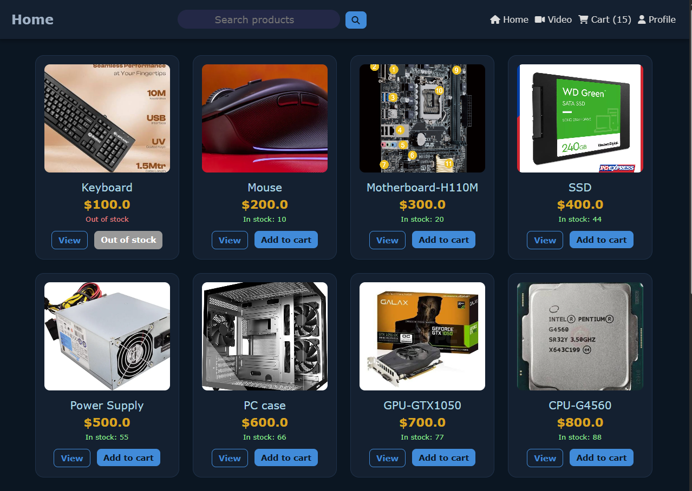
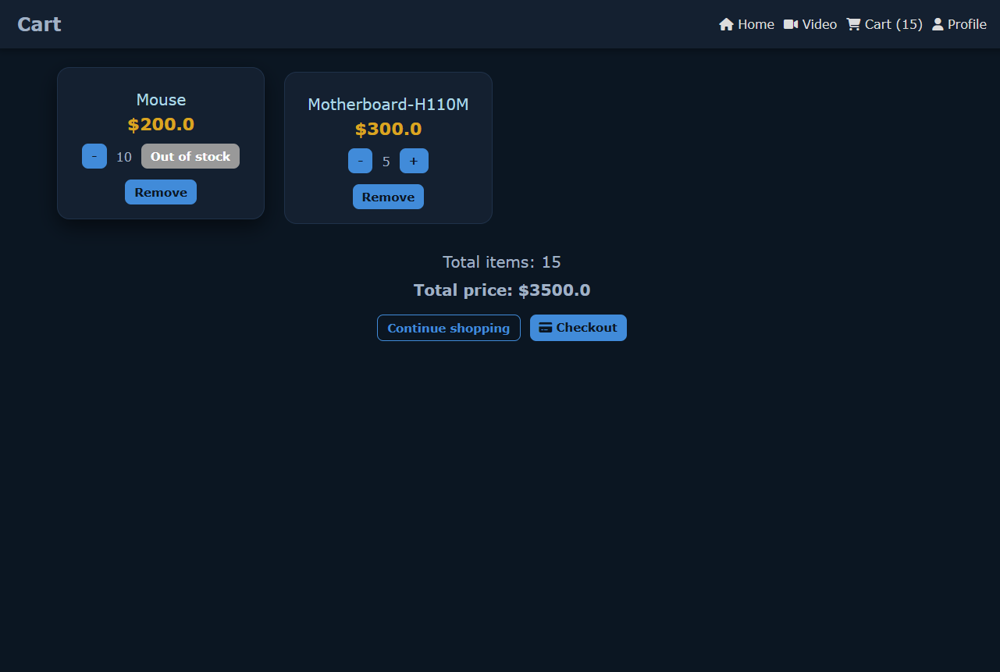
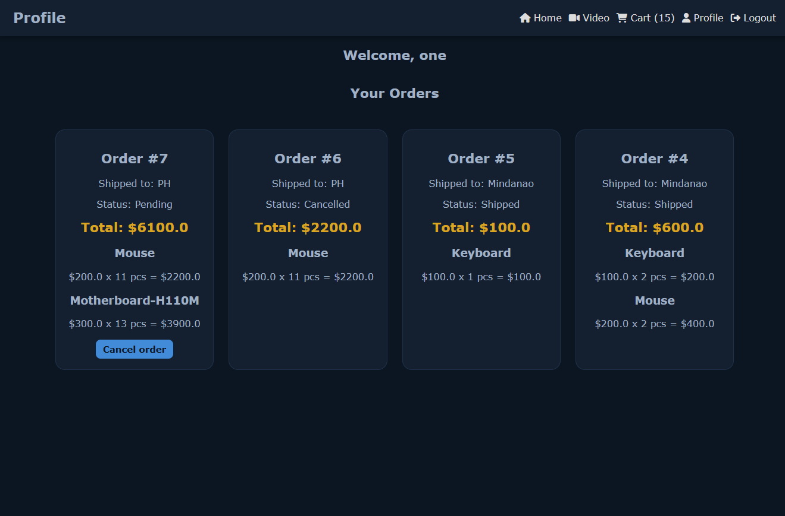
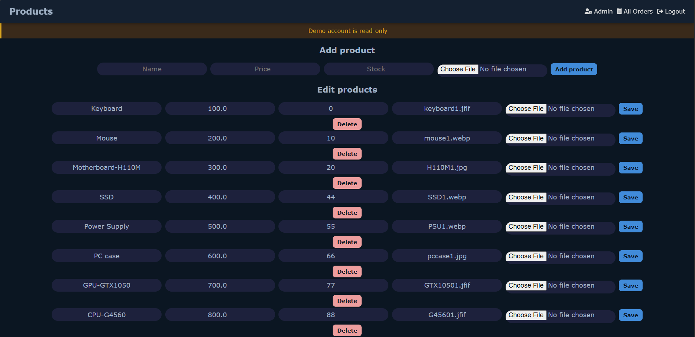
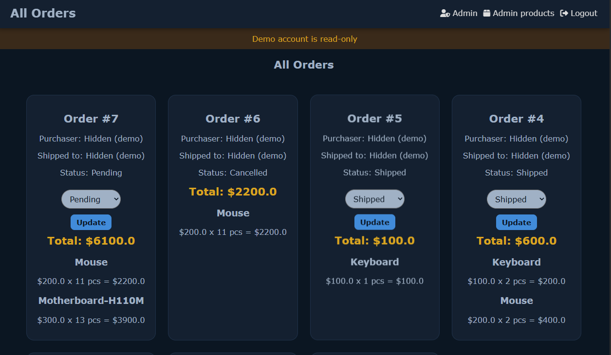

# Store Website

A simple online store built with Flask. Users can register, add products to a cart, place orders and cancel them. Admins can manage products and orders.

**Live demo:** https://practice-002-store-project.onrender.com/

## Demo admin (read-only)

- Email: `demo@example.com`
- Password: `demo`

The demo account can view the admin pages but cannot change anything. Customer names and addresses are hidden.

## Features

- Register and login
- Login rate limit (5 attempts per minute)
- Product list, search and product pages
- Out of stock label
- Shopping cart with stock check
- Place orders and view order history
- Cancel order (stock is returned)
- Admin dashboard
- Admin: add, edit and delete products
- Admin: image upload for products
- Admin: view orders and update their status
- CSRF protection on all forms

> Image upload works locally. On the live demo, uploaded images are not saved permanently.

## Built with

Python, Flask, SQLite (local), PostgreSQL (live), HTML, CSS, Flask-WTF, Flask-Limiter

## What I learned

- Flask routes, templates and sessions
- SQL with SQLite and PostgreSQL
- Login security: password hashing, CSRF protection, rate limiting
- Deploying a Flask app on Render
[review notes](REVIEW.md)

## Screenshots

## How to run

1. Clone the project: `git clone https://github.com/elcollados/Store-website.git`
2. Go into the folder: `cd Store-website`
3. Install packages: `pip install -r requirements.txt`
4. Create a `.env` file with: `SECRET_KEY=<any long random text>`
5. Run: `python app.py`
6. Open `http://127.0.0.1:5000`

To make an admin locally, register a user, then set `is_admin = 1` in the 'users2' table.

## About this project

I built this while learning Flask, I used AI to help write most of the code. I typed it myself, tested it, and learned how each part works.
Product images are for demo only.